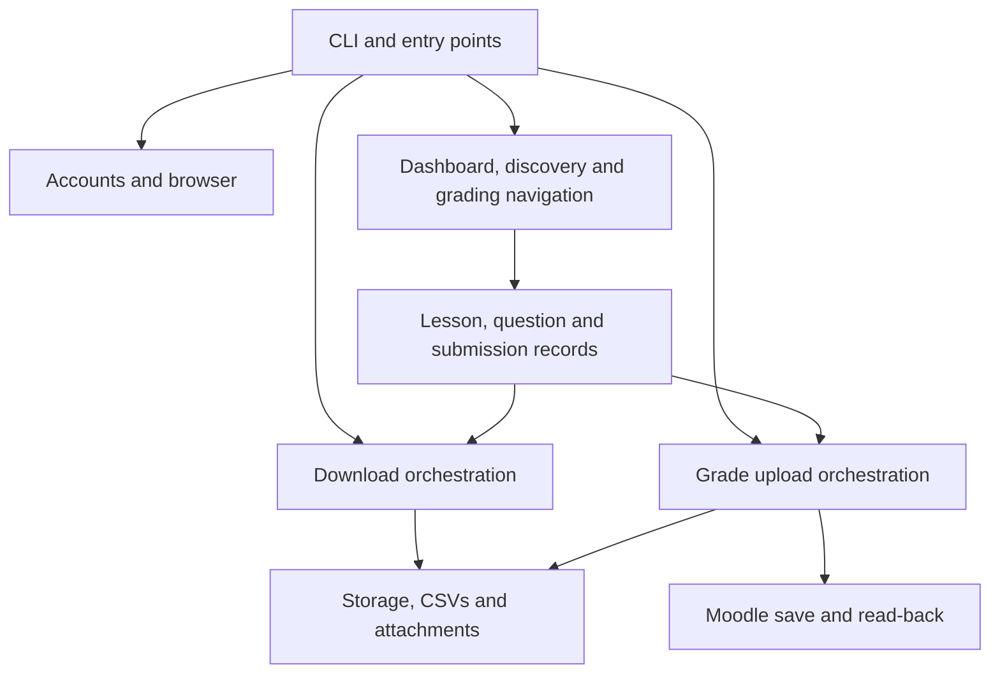
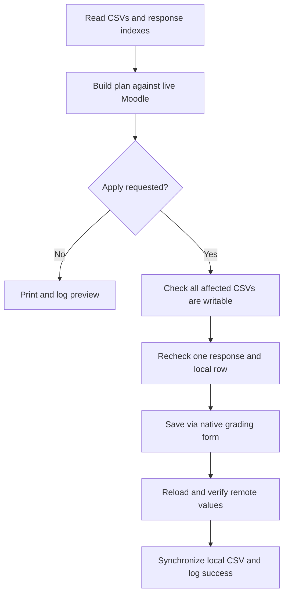

# Architecture and interaction model

[Index](README.md) · [Operator guide](../USAGE.md) · [Data contracts](DATA_AND_LOGS.md)

## Layers and boundaries

The CLI chooses the command and owns the authenticated browser lifetime. Parsers
convert site HTML into immutable records. Workflow modules navigate and combine
those records. Storage modules manage local state. `grade_upload` alone submits
grading forms. This separation lets a selector/parser change be tested without
real credentials, while filesystem behavior can be tested in temporary directories.

The diagram shows functional data flow. The exact local imports and function
signatures are listed in each [module reference](README.md#source-modules).
`moodle.py` supplies shared origin/selectors to parser and navigation layers.
`errors.py` supports sanitized discovery diagnostics; `upload_io.py` supports
pre-save local write checks.

## Shared records and identity

| Record | Defined in | Created by | Consumed by |
| --- | --- | --- | --- |
| `Lesson` | dashboard.py | Dashboard parsing, course discovery, saved-history loading | CLI presentation, storage, grading, export, upload |
| `PendingQuestion` | grading.py | Manual-grading table parsing | Pending-tab inspection, export queues, upload planning |
| `Upload` | submissions.py | Attachment link parsing | files.download_upload |
| `Submission` | submissions.py | Essay response parsing | Export roster/CSV, upload identity and mark checks |
| `Edit` | grade_upload.py | CSV/index reading | Live comparison and apply logic |
| `Change` | grade_upload.py | Validated live comparison | Preview, write-access checks, apply and verification |

A course ID identifies the course; a quiz activity ID is used in lesson URLs and
--lesson-id. A slot identifies a question position, and qid appears in the report
URL. A response key `<question_usage_id>:<slot>` identifies a response within the
saved local index. Names alone are not adequate identity: two attempts may share
a student's name. These IDs must not be substituted for one another.

## Authentication sequence

1. Entry point calls cli.main; argparse selects the command/account.
2. accounts loads the explicit Windows credential backend and validates its record.
3. browser starts an isolated headless context, validates the login destination,
   submits credentials once and waits for an authenticated marker.
4. The command uses that page/context, including its authenticated request client.
5. Exiting the context manager closes all pages and the browser, including error paths.

No persistent cookie profile or exported storage-state file is created. `add` and
`remove` use the credential backend without starting Playwright.

## Dashboard summary sequence

`cli → dashboard.read_dashboard → parse_dashboard → Lesson[] → print_lessons +
storage.append_scan`.

Only the Grade Me block is used. Counts are observations from its badge and rendered
entry list. `grading` continues via grading.open_pending_grading to open each pending
question link. Neither command exports student attachment files or saves marks.

## Full download sequence

1. discovery captures/replays My Courses AJAX and enumerates all/hidden courses.
2. Each course's quiz index is parsed; an empty match set triggers course-page fallback.
3. storage.remember_lessons appends discovery records; merge_known_lessons combines
   live URLs with saved ones. Existing folders are resolved by stable prefixes.
4. export visits each quiz through grading.pending_questions_for_lesson(include_all=True).
5. For each question it queues graded/ungraded/all report URLs, requests stable
   studentlastname ordering, follows rendered paging, and deduplicates response keys.
6. submissions.parse_submissions associates each response with its heading, prompt,
   mark and allowed attachment links. Export writes the description and synchronizes
   the roster using csv_store.
7. files checks saved download hashes, fetches conditionally where possible, saves
   new content without overwriting old bytes, extracts ZIPs and appends history.
8. Attachment errors continue to later files; broader errors stop the current lesson
   and are accumulated while later lessons are attempted. Failure is reported at end.

There is no saved browser cursor. A retry scans from discovery again and uses stable
local identities and conditional requests to avoid duplicating completed outputs.
This is why new submissions can still be discovered after an earlier successful run.

## Grade upload sequence

The apply sequence repeats for each proposed response. Already graded responses
are removed during planning; if a response becomes graded later, apply skips it.
An identity mismatch, changed preflight value, or changed local row stops the
operation. No grade is inferred from a question's maximum mark.

The plan reads all CSVs before filtering to a selected lesson. Preview is read-only
with respect to Moodle but writes local audit logs. --apply rebuilds the plan;
there is no persisted plan token. Global preflight prevents known mapping failures
from causing a partial upload, but a later runtime failure can occur after earlier
responses have been saved. There is no multi-response transaction or rollback.

## Error boundaries and recovery

| Boundary | Behavior |
| --- | --- |
| Login | One submission attempt; no credential retry loop |
| Course discovery | Abort if discovery cannot establish its list; do not claim zero success |
| HTML parser | Raise MoodleLayoutError for missing/ambiguous required structure |
| Attachment | Record failure type, try remaining files; original bytes remain |
| Lesson export | Continue other lessons; aggregate failure at end |
| Upload preflight | Abort before saves if selected response identity/range/form validation fails |
| Local upload write probe | Abort before first save when a CSV cannot be replaced |
| Post-submit verification | Log uncertainty; do not auto-repeat a potentially completed save |
| Verified remote/local sync failure | Report remote success separately from local failure |

The CSV/index pair is not committed atomically; a crash between file updates can
require paired restoration. Local output is not an authoritative transaction log
of the whole server, and removing logs does not reset Moodle grades.

## Maintaining the site adapter

For a changed theme, first inspect moodle.py selectors and the relevant pure parser.
For a translated attempt heading, update submissions.ATTEMPT and its fixtures. For
changed course-list service behavior, update discovery's capture/envelope logic.
For a new grading editor/form, update grade_upload's validated controls and note
handling. Keep report order set to a real dropdown option value and preserve
identity checks even if the page layout changes.

Add focused regression fixtures for the observed change, using synthetic names and
no session keys. Run the relevant test file and full suite. Verify the corrected
behavior on Windows/Moodle separately; offline parser success alone does not prove
authentication, selector visibility, JavaScript editor behavior or permission checks.
Do not solve a parser failure by silently skipping identities or weakening
same-origin/form validation.

## Current limitations

- Only quiz essay-response attachments are exported; assignment activities and
  arbitrary Moodle question types are not implemented.
- The browser is hardcoded headless, and some prompts still assume visible inspection.
- No account-list command, download lesson filter, overwrite-graded flag, scheduler,
  consolidated local grading report, or remote rollback is implemented.
- Some raw markup assumptions remain outside moodle.py.
- Dependency ranges are not locked; Python 3.10+ syntax is used.
- No locking or durable multi-file transaction supports concurrent writers.
- Logs grow without rotation and contain student information; they are runtime data
  excluded by .gitignore, not documentation fixtures.
